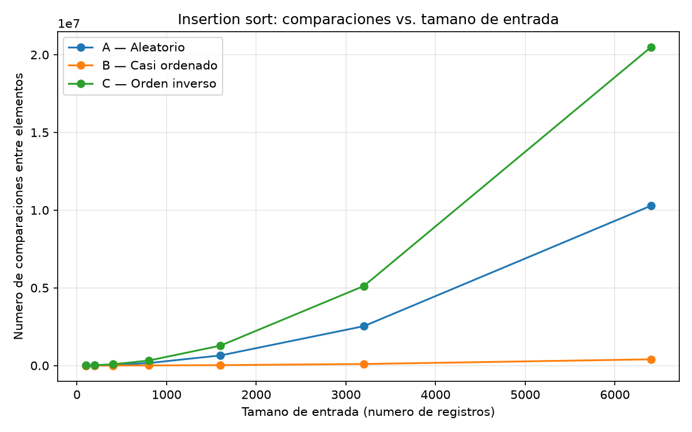
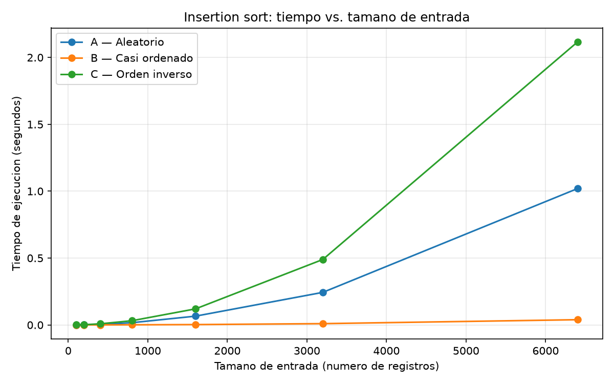
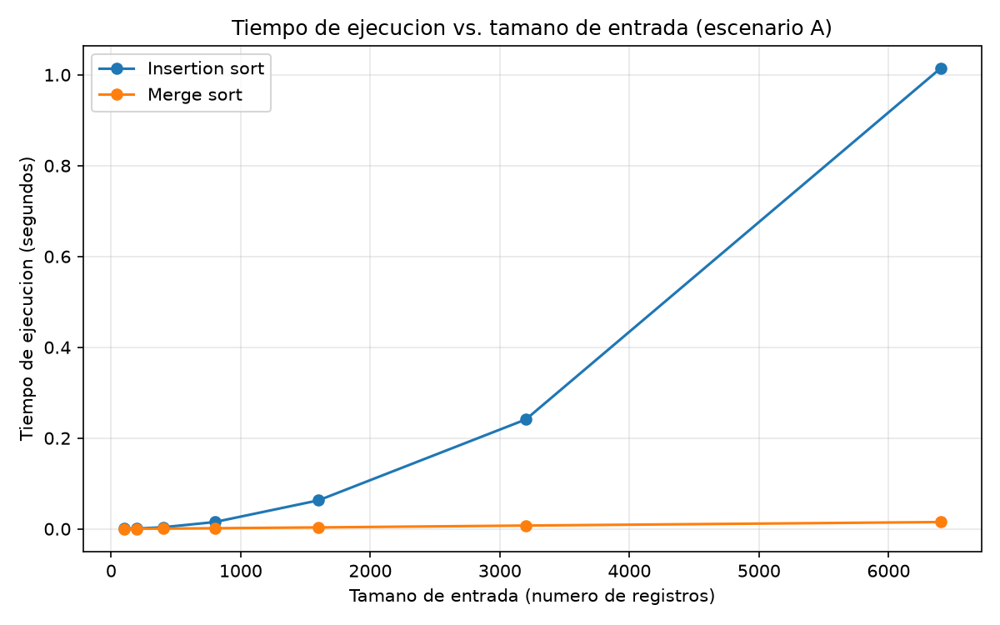

# Laboratorio 1 — Fundamentos, complejidad y recurrencias

Juan Andrés Ramírez Castañeda

Para todo el laboratorio trabajé el ordenamiento de los índices de riesgo de mayor a menor, ya que ese es el orden que necesita Tamiza para llamar primero a los pacientes con mayor riesgo.

Para las pruebas se utilizaron listas de n números enteros diferentes entre 0 y n - 1. Se hizo de esta forma porque para tamaños como n = 6400 no sería posible mantener todos los valores distintos usando solamente índices entre 0 y 1000.

Los tiempos fueron medidos con time.perf_counter() y únicamente se tomó el tiempo que tarda el algoritmo, sin incluir la generación de los datos.

# Cómo reproducir el experimento

Desde la raíz del repositorio:

```powershell
.\venv\Scripts\Activate.ps1

pip install -r requirements.txt

cd laboratorios\lab1-fundamentos-complejidad-recurrencias

python parte3_casos.py

python parte4_complejidad.py
```

---

# Parte 1 — Analizar el algoritmo antes de comprar hardware

El hecho de que insertion sort lleve varios años funcionando en Tamiza no significa que todavía sea una buena solución para el volumen de información actual. El algoritmo es correcto porque sí logra cumplir su funcion de ordenar los registros de mayor a menor según el índice de riesgo. El problema está en que ahora necesita procesar 1.200.000 registros que son demaciados y debe terminar obligatoriamente antes de las 6:00 a. m.

Por eso es muy importante diferenciar entre que un algoritmo sea correcto y que sea viable para el problema actual. ya que este algoritmo puede entregar el resultado esperado, pero si tarda mucho más de las cuatro horas disponibles, entonces no estaria cumpliendo con una de las condiciones principales de este sistema.

Comprar un servidor con el doble de velocidad puede ayudar a disminuir el tiempo, pero no cambia la forma en que crece el insertion sort. Cuando los datos están muy desordenados, su tiempo aumenta aproximadamente de forma cuadratica. Si anteriormente se trabajaba con cerca de 20.000 registros y ahora hay 1.200.000, la cantidad de información aumentó 60 veces eso es algo insostenible. En un comportamiento cuadrático eso puede representar un crecimiento cercano a 60² = 3600 veces en el trabajo realizado.

Supongamos que un servidor dos veces más rápido lograra reducir el tiempo aproximadamente a la mitad, esto no es una solucion, seguiríamos teniendo un algoritmo cuyo costo aumenta demasiado rápido a medida que crecen los datos. Es decir, se  estaria aplazando el problema en lugar de solucionarlo.

Un ejemplo parecido puede verse en un sistema universitario de matrículas. Imaginemos unos 15.000 estudiantes consultando grupos y horarios durante el mismo periodo. Si para buscar cada grupo el sistema recorre una lista completa de miles de registros, puede encontrar correctamente la información, pero tardar 15 o 20 segundos por consulta. Aunque el resultado sea correcto, para una plataforma de matrícula esa demora puede hacer que un estudiante pierda un cupo. En ese caso la restricción que se está incumpliendo no es la corrección del resultado, sino el tiempo de respuesta.

Por esto, antes de comprar hardware considero que primero debe revisarse si el algoritmo utilizado sigue siendo apropiado para el tamaño actual del problema.

---

# Parte 2 — Responsabilidad ambiental y ética

La elección del algoritmo en Tamiza no afecta solamente al servidor. El proceso se ejecuta todas las madrugadas y trabaja sobre información de 1.200.000 pacientes, por lo que una mala decisión técnica puede terminar teniendo consecuencias tanto ambientales como para las personas.

Desde el punto de vista ambiental, mientras más tiempo se encuentre ejecutándose el proceso, más tiempo permanecen trabajando el procesador, la memoria, el almacenamiento y los sistemas de refrigeración del servidor. La diferencia puede parecer pequeña si se analiza una sola ejecución, pero este proceso se realiza todos los días.

Si un algoritmo tarda varias horas adicionales cada noche, ese consumo termina acumulándose durante los 365 días del año y durante todos los años que permanezca funcionando el sistema. Por eso reducir el trabajo innecesario del servidor también significa disminuir el consumo energético acumulado.

El problema más importante, sin embargo, está en las personas que dependen del resultado.

Un primer caso sería el de un paciente con un índice de riesgo alto cuyo registro todavía no fue procesado cuando llega la hora de abrir el centro de contacto. Si la lista queda incompleta, esa persona puede ser llamada después de alguien con menor riesgo. En ese caso el principal costo del error lo asume el paciente, porque puede retrasarse una valoración médica que era prioritaria.

Un segundo afectado es el trabajador del centro de contacto. Si a las 6:00 a. m. recibe una lista incompleta o incorrectamente ordenada, tiene que trabajar con información que no refleja correctamente las prioridades. El operador asume parte del problema durante su jornada, pero nuevamente los pacientes también resultan afectados.

La Secretaría también tiene una responsabilidad porque presta el servicio, y el equipo de desarrollo tiene responsabilidad sobre las decisiones técnicas que permiten que el proceso continúe fallando.

Además, en Tamiza el ordenamiento tiene una importancia especial. No se está ordenando una lista únicamente para mostrarla en una pantalla: el resultado determina quién recibe una llamada primero.

Por esa razón no basta con lograr que el algoritmo termine rápido. También debe garantizarse que el orden sea correcto. Si un paciente con mayor riesgo queda después de otro con menor riesgo, se está modificando directamente el orden de atención establecido por el sistema. Si existieran pacientes con el mismo índice, también sería conveniente definir un criterio claro para decidir cómo conservar su orden.

Por esto, elegir el algoritmo adecuado es al mismo tiempo una decisión de rendimiento y una responsabilidad relacionada con el servicio que reciben los pacientes.

---

# Parte 3 — Peor caso, mejor caso y caso promedio

Código utilizado:

* [parte3_casos.py](parte3_casos.py)
* [algoritmos.py](algoritmos.py)
* [datos.py](datos.py)

## 3.1 Explicación y predicción

Para analizar los casos se debe mantener fijo el tamaño n y observar las distintas formas en que pueden llegar los datos.

El mejor caso corresponde a la entrada de tamaño n que produce la menor cantidad de trabajo para el algoritmo.

El peor caso corresponde a la entrada del mismo tamaño n que produce la mayor cantidad de trabajo.

El caso promedio busca representar el costo esperado considerando las diferentes entradas posibles de tamaño n.

Para Tamiza considero más importante analizar el peor caso porque existe una ventana estricta de cuatro horas. No sería suficiente saber que normalmente termina a tiempo si existe un tipo de entrada que puede hacer que el sistema vuelva a superar las 6:00 a. m.

Antes de hacer las mediciones mi predicción fue:

* **Escenario C:** peor caso, porque los elementos llegan exactamente en el orden contrario al requerido.
* **Escenario B:** mejor caso, porque el 98 % de la lista ya está prácticamente en el orden correcto.
* **Escenario A:** aproximación al caso promedio, porque los datos llegan en orden aleatorio.

## 3.2 Demostración experimental

Se realizaron pruebas con tamaños de 100, 200, 400, 800, 1600, 3200 y 6400 elementos.

Los resultados obtenidos fueron:

|    n | Escenario | Tiempo (s) | Comparaciones |
| ---: | :-------: | ---------: | ------------: |
|  100 |     A     |   0.000375 |          2542 |
|  100 |     B     |   0.000017 |           193 |
|  100 |     C     |   0.000655 |          4950 |
|  200 |     A     |   0.001366 |          9970 |
|  200 |     B     |   0.000052 |           580 |
|  200 |     C     |   0.001720 |         19900 |
|  400 |     A     |   0.003731 |         40436 |
|  400 |     B     |   0.000162 |          1612 |
|  400 |     C     |   0.008323 |         79800 |
|  800 |     A     |   0.016601 |        160484 |
|  800 |     B     |   0.000918 |          7194 |
|  800 |     C     |   0.031409 |        319600 |
| 1600 |     A     |   0.065590 |        648481 |
| 1600 |     B     |   0.002611 |         26545 |
| 1600 |     C     |   0.120129 |       1279200 |
| 3200 |     A     |   0.243511 |       2533103 |
| 3200 |     B     |   0.009619 |         98528 |
| 3200 |     C     |   0.489372 |       5118400 |
| 6400 |     A     |   1.019245 |      10276753 |
| 6400 |     B     |   0.039027 |        399911 |
| 6400 |     C     |   2.115124 |      20476800 |

### Comparaciones



### Tiempo de ejecución



Los resultados coincidieron con la predicción inicial.

El escenario C terminó siendo claramente el más costoso. Para n = 6400 llegó a 20.476.800 comparaciones y tardó 2.115124 segundos.

El escenario B tuvo un comportamiento completamente diferente. Con los mismos 6400 elementos solamente hizo 399.911 comparaciones y tardó 0.039027 segundos. Esto muestra la ventaja que tiene insertion sort cuando recibe una lista que ya está casi ordenada.

El escenario A quedó entre los dos. Para n = 6400 realizó 10.276.753 comparaciones y tardó 1.019245 segundos, por lo que se puede tomar como una aproximación al caso promedio.

Las diferencias también se ven claramente en las gráficas. El escenario C aumenta mucho más rápido, el B se mantiene bastante más bajo y el A queda aproximadamente en la mitad.

---

# Parte 4 — Complejidad de merge sort e insertion sort

Código utilizado:

* [parte4_complejidad.py](parte4_complejidad.py)
* [algoritmos.py](algoritmos.py)

## 4.1 Cálculo teórico

Merge sort divide el problema original en dos partes, ordena cada una de forma recursiva y finalmente mezcla los resultados.

Por esto su recurrencia es:

```text
T(n) = 2T(n/2) + Θ(n)
```

El 2 aparece porque se generan dos subproblemas.

Cada subproblema tiene tamaño n/2.

Finalmente, Θ(n) corresponde al trabajo necesario para combinar las dos mitades, ya que durante la mezcla se recorren los elementos.

Para resolver la recurrencia utilizo el método maestro.

Tenemos:

```text
a = 2
b = 2
f(n) = Θ(n)
```

Calculamos:

```text
n^(log_b(a))

n^(log_2(2))

n^1 = n
```

Como:

```text
f(n) = Θ(n)
```

entonces:

```text
f(n) = Θ(n^(log_b(a)))
```

Esto corresponde al caso 2 del método maestro, por lo tanto:

```text
T(n) = Θ(n log n)
```

### Análisis de insertion sort

En insertion sort se realiza una copia de los datos y posteriormente se recorren los elementos desde la segunda posición.

El ciclo for se ejecuta n - 1 veces.

En el mejor caso, la lista ya se encuentra en el orden requerido. Cada elemento necesita prácticamente una comparación antes de continuar, por lo que se realizan aproximadamente:

```text
n - 1
```

comparaciones.

Por eso:

```text
Θ(n)
```

En el peor caso, cada elemento tiene que compararse con todos los elementos anteriores.

La cantidad de comparaciones es:

```text
1 + 2 + 3 + ... + (n - 1)
```

que puede escribirse como:

```text
n(n - 1) / 2
```

Por lo tanto:

```text
Θ(n²)
```

En un caso promedio sigue existiendo una cantidad proporcional a n² de desplazamientos y comparaciones, por lo que también obtenemos:

```text
Θ(n²)
```

| Algoritmo      | Mejor caso | Caso promedio | Peor caso  |
| -------------- | ---------- | ------------- | ---------- |
| Insertion sort | Θ(n)       | Θ(n²)         | Θ(n²)      |
| Merge sort     | Θ(n log n) | Θ(n log n)    | Θ(n log n) |

---

## 4.2 Validación experimental

La prueba se realizó sobre el escenario A, utilizando los mismos tamaños empleados en la Parte 3.

Los tiempos obtenidos fueron:

|    n | Insertion sort (s) | Merge sort (s) |
| ---: | -----------------: | -------------: |
|  100 |           0.000448 |       0.000138 |
|  200 |           0.000844 |       0.000300 |
|  400 |           0.003589 |       0.000679 |
|  800 |           0.015152 |       0.001541 |
| 1600 |           0.062894 |       0.003301 |
| 3200 |           0.241011 |       0.007349 |
| 6400 |       **1.014086** |   **0.015094** |



La diferencia entre los algoritmos se vuelve más clara a medida que aumenta n.

Con 100 elementos insertion sort tardó 0.000448 segundos y merge sort 0.000138. En este equipo merge sort ya fue más rápido incluso para ese tamaño, aunque la diferencia todavía era muy pequeña.

La separación realmente importante aparece cuando aumenta el número de elementos. Para n = 6400, insertion sort tardó 1.014086 segundos, mientras que merge sort necesitó solamente 0.015094 segundos.

Eso quiere decir que, en esa medición, insertion sort tardó aproximadamente 67 veces más.

La forma de las curvas también coincide con el análisis teórico. La de insertion sort comienza a crecer cada vez con mayor rapidez, como se espera de un comportamiento `Θ(n²)`. Merge sort aumenta mucho más lentamente, de acuerdo con su complejidad Θ(n log n).

Por esta razón, los resultados experimentales respaldan lo obtenido en el análisis de complejidad.

---

## 4.3 Concepto técnico a la Secretaría de Salud

Después de revisar las mediciones, mi recomendación es reemplazar insertion sort por merge sort para el proceso nocturno de Tamiza.

La razón principal no es solamente que merge sort haya sido más rápido en mis pruebas, sino que ofrece un comportamiento mucho más estable cuando cambia la forma en que llegan los datos. Tamiza puede recibir un lote aleatorio, uno casi ordenado o incluso uno en el orden contrario. Además, el canal puede cambiar sin previo aviso y el equipo no quiere mantener una implementación diferente para cada situación.

Insertion sort tiene una ventaja grande en el escenario B. En mis pruebas con 6400 elementos, el lote casi ordenado tardó únicamente 0.039027 segundos. El problema es que esa ventaja desaparece cuando cambia la entrada. Con el escenario A tardó 1.019245 segundos, y con el escenario C llegó a 2.115124 segundos. Por eso no considero conveniente depender de que los datos siempre continúen llegando casi ordenados.

Para tener una referencia del lote real de 1.200.000 registros hice una extrapolación. Es importante aclarar que esto es una estimación y no una medición del lote real.

Desde 6400 hasta 1.200.000 registros el tamaño aumenta aproximadamente 187,5 veces.

En la comparación de la Parte 4, insertion sort tardó 1.014086 segundos para 6400 elementos. Como su comportamiento promedio es aproximadamente cuadrático, el tiempo puede escalar usando 187,5², que es aproximadamente 35.156.

La estimación sería entonces:

```text
1.014086 × 35.156 ≈ 35.651 segundos
```

Eso corresponde aproximadamente a 9,9 horas.

La ventana disponible es de solamente cuatro horas. Incluso suponiendo de manera muy favorable que un servidor con el doble de velocidad redujera el tiempo exactamente a la mitad, estaríamos hablando de cerca de 4,95 horas, que todavía supera la ventana.

Para merge sort la situación cambia bastante. En n = 6400 tardó solamente 0.015094 segundos. Al extrapolar respetando un crecimiento n log n, el factor aproximado es 299,5. Esto produce:

```text
0.015094 × 299,5 ≈ 4,52 segundos
```

De nuevo, este número es solamente una estimación basada en mis mediciones y en el comportamiento esperado del algoritmo. No significa que haya ejecutado merge sort realmente con 1.200.000 registros.

Los resultados hacen que comprar primero un servidor del doble de velocidad no parezca la mejor solución. En la propia gráfica, con solamente 6400 elementos, insertion sort tarda 1.014086 segundos frente a los 0.015094 segundos de merge sort. Aumentar la velocidad del servidor puede reducir una constante, pero no modifica el crecimiento cuadrático de insertion sort.

También hay que considerar que merge sort utiliza memoria adicional durante el proceso de mezcla. Ese es un costo real que insertion sort no tiene de la misma manera. Sin embargo, para este caso considero que es un compromiso razonable frente a la reducción del tiempo y, especialmente, frente a la seguridad de tener un comportamiento Θ(n log n) sin depender del orden en que llegue el lote.

Por estas razones recomendaría cambiar el algoritmo a merge sort antes de invertir en un servidor únicamente para mantener funcionando la implementación actual.