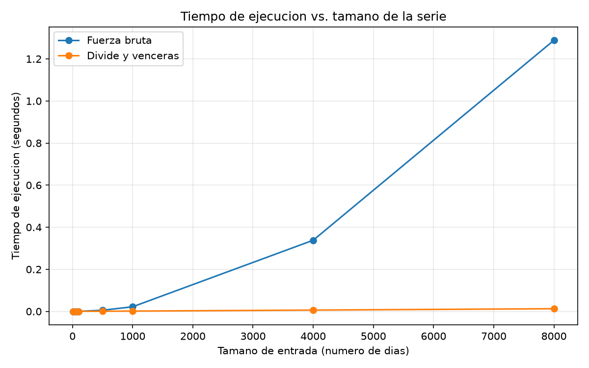

# Laboratorio 2 — Dividir y vencer

**Nombre:** Juan Andres Ramirez Castañeda

Para realizar las mediciones ejecute cada algoritmo tres veces y despues utilice la mediana de esos tiempos. Use time.perf_counter() y solamente medi el tiempo que tarda el algoritmo, esto sin contar la creación de las listas.

Para que los resultados se puedan repetir, utilice una semilla fija de 42 y numeros aleatorios entre -100 y 100.

## Como reproducir el experimento

Desde la raíz del repo:

```powershell
.\venv\Scripts\Activate.ps1
python -m pip install -r requirements.txt
cd laboratorios\lab2-divide-y-vencer
python pruebas.py
python medicion.py
```

---

# Parte 1 — Implementar y verificar

Código: [subarreglo.py](subarreglo.py) y [pruebas.py](pruebas.py).

Para realizar la solucion del problema hice dos algoritmos.

El primero es el de fuerza bruta, el cual revisa las diferentes combinaciones posibles de inicio y fin y luego va acumulando la suma para encontrar cual tiene el mayor resultado.

En el segundo utilice divide y venceras. para este caso, la lista se divide en dos partes y se busca el mejor resultado tanto para la izquierda, la derecha y ademas uno que pueda comenzar en la izquierda y terminar en la derecha.

Despues compare los resultados de ambos algoritmos para comprobar que estuvieran funcionando de manera correcta.

Las pruebas que realice fueron:

La serie de ocho dias que dieron de ejemplo, donde el resultado da 17.

Una lista con un numero.

Una lista donde todos los numeros son negativos.

Una lista donde todos los numeros son positivos.

Un caso donde la mejor racha pasa por el centro: [1, -10, 5, 6], con un resultado de 11.

25 listas aleatorias en las que los dos algoritmos debian obtener la misma suma.

A lo que todas estas pruebas pasaron correctamente.

---

# Parte 2 — Medir y graficar

Código: [medicion.py](medicion.py).

para este probe los algoritmos con listas de diferentes tamaños: 10, 50, 100, 500, 1000, 4000 y 8000 elementos.

Para cada tamaño utilice exactamente la misma lista en los dos algoritmos. Además, comprobe que los dos entregaran la misma suma antes de guardar el tiempo.

|    n | Fuerza bruta (s) | Divide y vencerás (s) | Suma   |
| ---: | ---------------: | --------------------: | -----: |
|   10 |         0.000005 |              0.000014 |   89.0 |
|   50 |         0.000053 |              0.000059 |  294.0 |
|  100 |         0.000208 |              0.000119 |  357.0 |
|  500 |         0.005457 |              0.000729 | 1200.0 |
| 1000 |         0.021978 |              0.001441 | 3441.0 |
| 4000 |         0.338151 |              0.006173 | 10403.0 |
| 8000 |         1.288423 |              0.012614 | 15394.0 |



En la grafica podemos notar que cuando aumenta la cantidad de datos vemos que la fuerza bruta empieza a crecer mucho mas rapido.

En cambio la linea de divide y venceras parece quedar casi pegada a la base de la grafica porque estos tiempos son mucho menores si los comparamos con los de la fuerza bruta.

---

# Parte 3 — Análisis

## 1. Recurrencia

En el algoritmo de divide y venceras el problema se tiene que dividir en dos partes iguales. por eso se hacen dos llamadas recursivas, cada una trabajando casi con la mitad de los datos.

Luego se entra a revisar el caso donde la mejor racha cruza por el centro. Para poder hacer esto hay que recorrer los elementos desde el centro hacia ambos lados, por lo que ese trabajo seria lineal.

Por esto la recurrencia quedaria:

```text
T(n) = 2T(n/2) + Θ(n),    T(1) = Θ(1)
```

Aplicando el metodo maestro seria:

a = 2
b = 2
f(n) = Θ(n)

Como log₂(2) = 1 entonces n^1 = n

f(n) también es Θ(n), por lo que corresponderia al caso numero 2 del metodo maestro.

para un resultado final de: T(n) = Θ(n log n)

En el de fuerza bruta se revisan todas las posibilidades de inicio y final de la racha.

La cantidad de combinaciones crece aproximadamente como n². además se va acumulando la suma y no vuelvo a recorrer todo desde cero, la complejidad queda en: Θ(n²)

## 2. Lo medido contra lo esperado

Los resultados medidos muestran que la fuerza bruta aumenta mucho mas rapido que si la comparamos con divide y vencerás. Para verlo de una manerra mas facil compare 4000 y 8000 elementos, porque en ese caso el tamaño se duplica y es mucho mas facil notar la relacion.

En fuerza bruta:

1.288423 / 0.338151 ≈ 3.81

Esto nos muestra que el tiempo aumenta aproximadamente 3.81 veces y vemos que tiene mucho sentido ya que como el algoritmo es Θ(n²), al duplicar este n se esperaria aproximadamente cuatro veces mas trabajo. Esto nos muestra que el resultado esta  muy cerca de lo esperado en la teoria.

En divide y vencerás:

0.012614 / 0.006173 ≈ 2.04

El tiempo aumenta aproximadamente dos veces. Esto tambien tiene todo el sentido del mundo porque su crecimiento es Θ(n log n), que se puede notar que aumenta mucho mas lento que n².

## 3. Tamaños pequeños

Con divide y venceras no fue mas rapido desde el comienzo, se comenzo con 10 elementos y fuerza bruta tardó: 0.000005 s mientras que divide y vencerás tardó: 0.000014 s. luego, con 50 elementos todavía estaban casi igualados. La verdadera diferencia se empieza a notar desde 100 elementos, donde divide y vencerás comienza a tardar menos.

Creo que esto pasa porque cuando hay pocos datos, el costo de hacer varias llamadas recursivas puede ser mayor que simplemente recorrer las pocas combinaciones que existen. Cuando la lista empieza a crecer, la diferencia entre n² y n log n se vuelve mucho más importante y divide y vencerás empieza a sacar mucha ventaja.

## 4. ¿Cuándo conviene dividir?

Creo que conviene dividir cuando separar un problema en partes más pequeñas reduce de forma importante el trabajo total y el costo de unir los resultados no es demasiado alto. Para hallar el máximo de un arreglo no se obtiene mejora, porque recorrerlo directamente cuesta Θ(n) y dividirlo tendría:

T(n) = 2T(n/2) + Θ(1)

que también da Θ(n).

Adenas este laboratorio sí conviene porque se pasa de Θ(n²) a Θ(n log n).

## 5. Concepto para la gerente

Le recomendaria utilizar divide y vencerás, especialmente porque se quieren analizar series mucho mas grandes. Esta es una estimación basada en mis mediciones, no una medición real con 1.000.000 de registros. Tomé como referencia el resultado de n = 8000.
Para llegar a 1.000.000, el tamaño aumentaria: 1.000.000 / 8000 = 125 veces
En fuerza bruta, como el crecimiento es cuadrático, el tiempo se multiplica aproximadamente por: 125² = 15.625
Con esto vemos que: 1.288423 × 15.625 ≈ 20.132 segundos lo cual equivale a 5,6 horas.
Para divide y vencerás utilicé el crecimiento n log n, comparando ambas cantidades:
125 × log₂(1.000.000) / log₂(8000) ≈ 192 entonces: 0.012614 × 192 ≈ 2,4 segundos se nota que la diferencia es muy grande. Por eso, pensando ademas en las 1.500 tiendas y en series futuras de cientos de miles de registros, escogeria divide y venceras.
