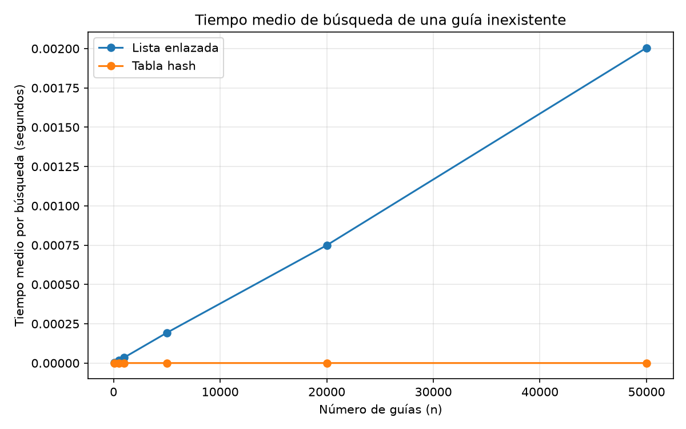
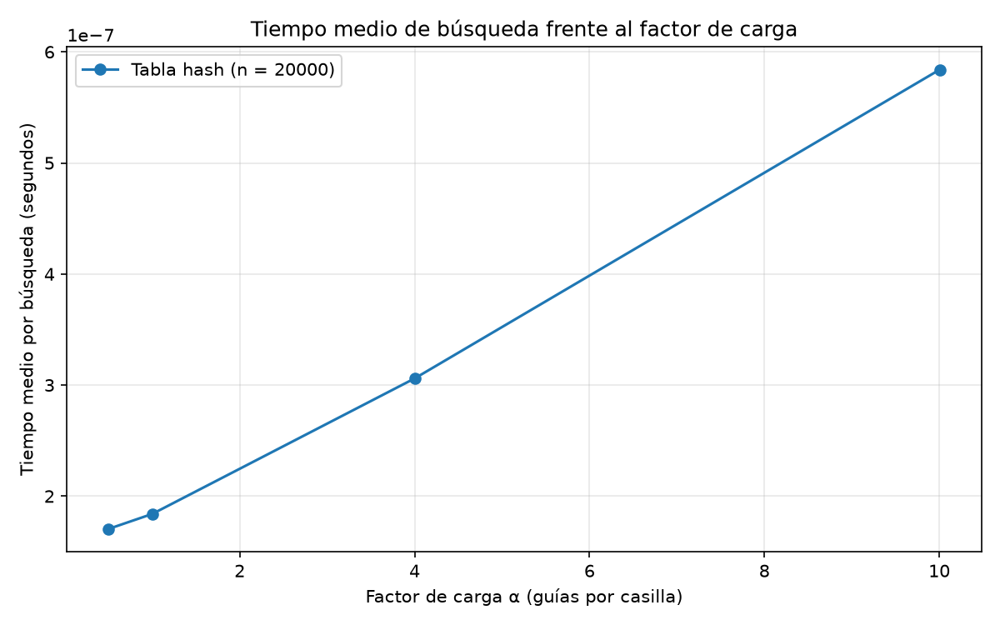

# Laboratorio 3 - Estructuras de datos

**Nombre:** Juan Andres Ramirez Castañeda

## Cómo ejecutar el laboratorio

Para ejecutar las pruebas y las mediciones, primero se debe abrir una terminal en la carpeta principal del repositorio y activar el entorno virtual.

```powershell
.\venv\Scripts\Activate.ps1
python -m pip install -r requirements.txt
cd laboratorios\lab3-estructuras-datos
python pruebas.py
python medicion.py
```

El archivo pruebas.py permite comprobar que las estructuras funcionan correctamente, mientras que medicion.py ayuda a realizar las mediciones y generar las graficas.

## Parte 1 - Implementacion y pruebas

**Archivos:** [estructuras.py](estructuras.py) y [pruebas.py](pruebas.py)

En esta primera parte implemente una lista enlazada y una tabla hash. La lista guarda cada guia nueva al principio y cuando se necesita buscar una entonces se recorren los nodos hasta encontrarla o llegar al final.

En la tabla hash utilice el modulo (guia % m) para saber en que casilla guardar cada una de las guias. Cuando varias llegan a la misma casilla estas se almacenan en una lista enlazada.

Para comprobar que funcionaran, hice pruebas buscando guias existentes y otras que no estaban guardadas.

Tambien probe las colisiones con las guías 10, 24 y 17 utilizando una tabla de 7 casillas. Las tres terminaron en la posicion 3 y pude comprobar que se guardaban y consultaban correctamente. Ademas, pude verificar que el tamaño de esa lista fuera 3 y que el factor de carga fuera 3/7.

Realice pruebas con 20 colecciones aleatorias para comparar las respuestas de ambas estructuras y en todos los casos comprobados devolvieron los mismos resultados.

## Parte 2 - Mediciones y graficas

**Archivo:** [medicion.py](medicion.py)

Para las mediciones utilice una semilla de 7, para que los datos se puedan volver a generar.

En cada tamaño realice 200 busquedas de guias inexistentes entonces repeti las mediciones tres veces y utilice la mediana de los resultados. Para medir el tiempo use time.perf_counter() esto teniendo en cuenta unicamente las busquedas, sin incluir la creacion de las estructuras.

### Experimento A - Lista enlazada frente a tabla hash

Aqui utilice seis cantidades diferentes de guias. Para la tabla hash escogi un numero primo de casillas cercano a la mitad de n, con un objetivo de mantener el factor de carga aproximadamente en 2.

| n | m | Factor de carga | Lista (s) | Tabla hash (s) |
|---|---|---|---|---|
| 100 | 47 | 2.1277 | 0.00000319 | 0.00000020 |
| 500 | 251 | 1.9920 | 0.00001593 | 0.00000020 |
| 1000 | 499 | 2.0040 | 0.00003542 | 0.00000022 |
| 5000 | 2503 | 1.9976 | 0.00019285 | 0.00000021 |
| 20000 | 10007 | 1.9986 | 0.00074925 | 0.00000027 |
| 50000 | 24989 | 2.0009 | 0.00200512 | 0.00000022 |



En la grafica se puede ver que el tiempo de la lista aumenta a medida que se agregan mas guias. En cambio el tiempo de la tabla hash practicamente no cambia.

La diferencia es tan grande que la linea de la tabla queda muy cerca del eje horizontal. entonces por eso tambien deje los valores en la tabla anterior.

### Experimento B - Factor de carga

Ya en esta segunda prueba mantuve 20.000 guias y cambie la cantidad de casillas de la tabla para observar que era lo que pasaba cuando aumentaba el factor de carga.

| Factor de carga | m | Tiempo (s) |
|---|---|---|
| 0.4999 | 40009 | 0.00000017 |
| 1.0002 | 19997 | 0.00000018 |
| 4.0008 | 4999 | 0.00000031 |
| 10.0050 | 1999 | 0.00000058 |



Con esto los resultados muestran que cuando hay mas guias por casilla las busquedas empiezan a tardar mas.Se pueve ver que esto tiene sentido porque aumentan las posibilidades de encontrar listas mas largas dentro de la tabla.

## Parte 3 - Analisis de resultados

### 1. Costo teorico de las estructuras

normalmente en una lista enlazada cuando buscamos una guia que no existe toca recorrer todos los nodos para comprobar que no esta entonces si tenemos 100 guias, se revisan 100, pero si tenemos 50.000, se deben revisar las 50.000. Por esto su complejidad es Θ(n).

La funcion de la tabla hash es diferente porque primero calcula la casilla donde deberia estar la guia y despues busca unicamente en la lista de esa posicion.

Su complejidad promedio es Θ(1 + α), donde α seria el numero de guias dividido entre la cantidad de casillas. Esto se cumple se suponemos que la funcion hash distribuye las guias de una manera uniforme, mejor dicho que todas las casillas tienen la misma posibilidad de recibir una guia.

entonces si todas las guias terminaran en una sola casilla, tendriamos una lista muy larga y la busqueda volveria a costar Θ(n).

### 2. Comparacion entre la teoria y los resultados

En la primera grafica compare los resultados de 20.000 y 50.000 guias.

La cantidad de guias aumento un total de 2,5 veces y el tiempo de la lista paso de 0,00074925 a 0,00200512 segundos. Esto es un aumento de aproximadamente 2,68 veces.

El resultado se acerca a lo esperado para Θ(n), porque al aumentar la cantidad de elementos tambien aumenta el tiempo de la busqueda.

En la tabla hash el tiempo paso de 0,00000027 a 0,00000022 segundos. entonces quedo en aproximadamente 0,81 veces el tiempo anteriormente marcado.

Para este caso los tiempos son tan pequeños que lo mas seguro es que varian por factores del computador pero Lo importante es que la busqueda se mantuvo practicamente constante, como se esperaba al conservar un factor de carga cercano a 2.

En la segunda grafica tambien encontre algo muy interesante. Cuando el factor de carga paso de aproximadamente 0,5 a 10, el tiempo aumento de 0,00000017 a 0,00000058 segundos, unas 3,41 veces.

Aunque no aumenta exactamente en la misma proporcion que la expresion Θ(1 + α) este si muestra la tendencia esperada: cuando hay mas elementos por casilla, buscar se vuelve mas lento. obviamente tambien influye el tiempo fijo que necesita cada busqueda.

### 3. ¿Que son las colisiones?

Ocurre cuando dos o mas guias terminan en la misma casilla de la tabla hash. Esto puede suceder hasta cuando tenemos mas casillas que guias, porque diferentes numeros pueden producir el mismo residuo.

Por ejemplo con m = 7 las guías 10, 24 y 17 producen residuo 3. Entonces todas llegan a la casilla 3.

Con el encadenamiento podemos guardar las tres en una lista enlazada dentro de esa casilla. La ventaja es que no perdemos ninguna guia y podemos seguir insertando elementos. La desventaja es que las listas ocupan memoria adicional y si crecen mucho las búsquedas tardan mas.

Otra opcion es el direccionamiento abierto. Aqui si una casilla esta ocupada se busca otra disponible dentro del mismo arreglo.

Esto evita utilizar listas adicionales, pero puede generar agrupaciones de elementos que hacen mas lentas las busquedas. Tambien requiere un manejo especial al eliminar elementos y necesita mantener casillas libres.

### 4. ¿Tabla hash o arbol de busqueda?

Para consultar el estado de una guia especifica utilizaria la tabla hash. pero para buscar todas las guias entre dos numeros no seria la mejor opcion.

Esto pasa porque la tabla hash no almacena las guias ordenadas. Para encontrar las que pertenecen a un rango tendriamos que revisar todas las casillas.

El arbol de busqueda binario permite organizar los valores, dejando los menores a la izquierda y los mayores a la derecha. Así podemos recorrer las guias en orden y consultar un intervalo. Su costo para un rango es Θ(h + k) en donde h es la altura del arbol y k la cantidad de resultados.

Pero también hay un problema, si insertamos las 400.000 guias en orden dentro de un arbol binario normal, se formarían nodos hacia un solo lado. Su altura seria 399.999 y una busqueda podria necesitar cerca de 400.000 comparaciones.

Por otro lado un arbol equilibrado tendria una altura cercana a log₂(400.000), aproximadamente 19 niveles lo que permitiria busquedas mucho mas eficientes.

### 5. Recomendación para la empresa

Despues de realizar y finalizar las pruebas, considero que la mejor opcion seria utilizar dos estructuras.

Para el call center escogería una tabla hash con encadenamiento, porque necesita consultar rápidamente una guia especifica. Para los supervisores utilizaría un arbol de busqueda equilibrado, ya que necesitan consultar guias dentro de un rango.

Tambien podriamos hacer una estimacion para 5.000.000 de envios utilizando los resultados obtenidos, Con 50.000 guias, la lista tardo 0,00200512 segundos en buscar una guia inexistente. Como la gráfica mostro un crecimiento aproximadamente lineal, al multiplicar la cantidad de guias por 100 podemos estimar un tiempo cercano a 0,20 segundos.

En la tabla hash con un factor de carga cercano a 2, el tiempo fue de 0,00000022 segundos. Si aumentamos las casillas junto con las guias y mantenemos ese factor, el tiempo podria seguir siendo del orden de microsegundos o menos, segun el equipo y las condiciones de ejecución. Estas cifras son estimaciones basadas en las pruebas, no mediciones realizadas con cinco millones de envios.

En conclusion, no reemplazaria la lista por una sola estructura para todo. Usaria la tabla hash para las consultas individuales y un arbol equilibrado para las busquedas por rangos, porque recordemos que cada uno resuelve mejor una necesidad diferente.